# From Bits to Bounds Check Elision — The Complete IICT 2026 Study Companion

> **What this is.** A self-contained teaching document that starts at "what is a bit" and ends at exactly the work in this repository (IICT 2026 paper #55: *Static Analysis for Bounds Check Elision in the Naga WGSL Compiler*). Read it in order; every part builds only on the parts before it.
>
> **Sources.** Everything about "the work" is taken from the repo's own evidence, not from memory: `iict2026_bounds_check_elision_v2.tex` (paper v2), `BOUNDS_CHECK_ELISION_FINDINGS.md`, `LITERATURE_BOUNDS_CHECK_ELISION_AND_IV.md`, `BOUNDS_CHECK_ELISION_TODO.md`, `AUDIT_INVENTORY.md`, `corpus_hit_rate/results/RESULTS.md`, and the git history of the `wgpu`, `naga`, `corpus_hit_rate`, and `bounds-check-testing-framework` repos.

---

## Part 0 — The map

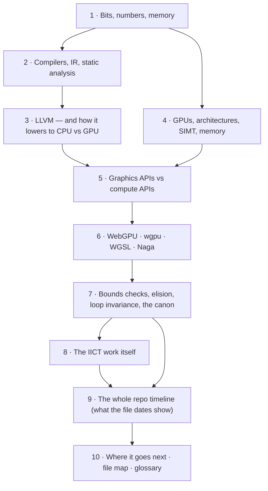

One sentence to hold onto for the whole document:

> **WebGPU forces every array access to be safe; this work removes the cost of that safety whenever the compiler can *prove* the access is safe — without ever being wrong.**

---

## Part 1 — Foundations: bits, numbers, memory

### 1.1 What is a bit?

The one truly unconditional truth everything rests on:

> **All data in a computer is bits — 0s and 1s — and all computation is manipulating bits.**

- A **bit** is one binary digit: 0 or 1.
- A **byte** is 8 bits → can represent $2^8 = 256$ values.
- A **32-bit word** is 4 bytes → $2^{32} = 4{,}294{,}967{,}296$ distinct bit patterns.
- The *same* 32 bits can be read as an integer, a float, an instruction, or a pointer. **Meaning is assigned by how the code interprets the bits**, not by the bits themselves.

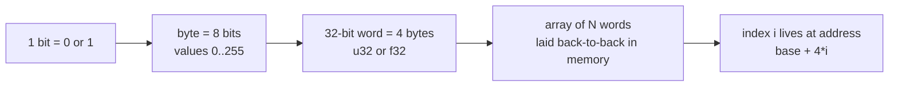

### 1.2 Unsigned, signed, and the wraparound trap

- **Unsigned integer (u32):** all 32 bits are magnitude. Range $[0, 4{,}294{,}967{,}295]$.
- **Signed integer (i32):** two's complement. Range $[-2{,}147{,}483{,}648,\; +2{,}147{,}483{,}647]$. The top bit is the sign.
- **WGSL defines integer arithmetic as modular (wrapping)** at the bit level.

Why this matters for *this* project specifically: in WGSL, `0u - 1u` does **not** error — it wraps to $2^{32}-1 = 4{,}294{,}967{,}295$. So if a shader does `data[lid - 1u]` with `lid = 0`, the index is a gigantic number. This exact case is one of the repo's 58 stress tests ("lid-1 unsigned wraparound! — must retain the check"). **An elision analysis that forgets wraparound is an unsound analysis.** Overflow discipline is not a corner case here; it is *the* hazard class for index arithmetic.

### 1.3 Memory and addresses

- Memory is one huge array of bytes; each byte has a numeric **address**.
- An array of 64 `f32` words occupies 64 × 4 = 256 contiguous bytes. Element `i` is at `base + 4*i`.
- An **out-of-bounds (OOB)** access computes an address outside the object: reading `data[70]` of a 64-element array reads *whatever lives 24 bytes past the end* — other variables, other buffers, or unmapped memory.
- **OOB reads** can leak data (security bug). **OOB writes** corrupt memory (correctness bug, exploitable bug). This is the entire motivation for bounds checking.

### 1.4 Undefined behavior (UB)

In C/C++/CUDA, an OOB access is **undefined behavior**: the standard puts no constraint on what happens. That is not just "it crashes" — it is worse: compilers are *allowed to assume UB never happens* and optimize on that assumption, so OOB can silently corrupt unrelated code, or "disappear" entirely. CUDA inherits exactly this: raw pointer arithmetic, no checks, UB on OOB (verified in this repo's CUDA benchmark section — *"CUDA has NO bounds check elision because CUDA has NO bounds checking at all"*, `BOUNDS_CHECK_ELISION_FINDINGS.md` §5).

**Hold on to the contrast — it is the axis this whole project lives on:**

| Model | OOB behavior | Who pays |
|---|---|---|
| CUDA / OpenCL / raw Vulkan (via `Unchecked`) | Undefined behavior | Nobody at runtime; the *user* pays in crashes/corruption |
| WebGPU / WGSL (spec-mandated) | **Defined** (reads return 0, writes dropped or clamped) | Every array access pays a runtime guard |

---

## Part 2 — Compilers, IR, and static analysis

### 2.1 What is a compiler?

A compiler is a program that translates a program from one language to another while preserving meaning. Every compiler, no matter the language, is a pipeline:


- **Lexer/parser:** turn text into a tree (AST). `data[lid + 1u]` becomes an `Access { base: data, index: lid + 1u }` node — the exact node shape this project's analyses walk.
- **Semantic analysis:** is `lid` a u32? Does `data` have a length? Type checking happens here — and, in Naga, so does bounds-check elision (in the *validator* stage, before any backend emits code).
- **IR:** see next.
- **Optimization:** passes that make the program faster/smaller *without changing observable behavior*. Eliding a provably-safe bounds check is precisely such a transform.
- **Codegen:** emit the target language/machine code.

### 2.2 Why an Intermediate Representation (IR)?

Suppose you have $N$ source languages and $M$ target machines. Writing a direct translator per pair is $N \times M$ compilers. Insert one IR in the middle and you need $N + M$ pieces:

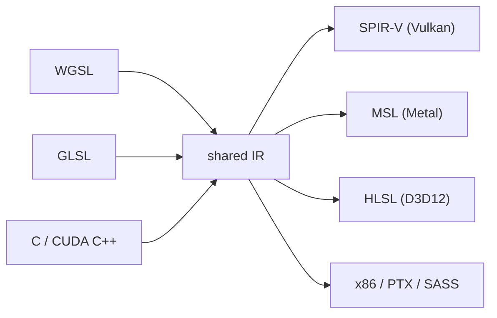

Real IRs you will meet in this document: **LLVM IR** (the dominant CPU-world IR), **SPIR-V** (the Khronos binary IR for Vulkan/OpenCL GPUs), **PTX** (NVIDIA's virtual ISA), and **Naga IR** (Naga's own Rust-side IR, which is what the elision analyses actually operate on).

### 2.3 Static analysis — the theory the rewrite uses

- **Static** = decided by inspecting the program text/IR, before running. **Dynamic** = decided at runtime.
- A static analysis is **sound** if everything it claims is guaranteed true at runtime. For bounds-check elision, sound means: *never* remove a check that could ever fail. An unsound elision is a security vulnerability generator — in a browser.
- Analyses are built on an **abstract domain**: instead of tracking the concrete value of `i` (could be anything), track a *summary* — e.g. an **interval** $[lo, hi]$.
  - This is **abstract interpretation** (Cousot & Cousot, 1977): "run" the program on abstract values (intervals) instead of concrete ones.
  - **Refinement:** at a branch `if i < 64`, on the taken edge the interval of `i` narrows to $[0, 63]$.
  - **Join:** where two paths merge, combine conservatively — take the *hull* of the two intervals, never the intersection.
  - **Termination:** domains are finite (there are finitely many u32 intervals you can generate with these rules), so the analysis always finishes.
- **Dataflow framing:** forward analysis propagating facts through a **control-flow graph (CFG)**, with facts valid per program point. This project's rewrite is exactly this shape, and the key design decision (§8.5) is that *each proof is attached to the specific `Access` expression at its program point* — facts cannot leak across statements, branches, or iterations.

### 2.4 CFG, SSA, phis, dominators — the vocabulary of every loop analysis

- **CFG:** nodes are basic blocks (straight-line runs), edges are jumps.
- **SSA (static single assignment):** each variable is assigned exactly once; merging values from different paths uses a **φ (phi) node**. `i = i + 1` in a loop becomes a cycle: `i₁ = φ(i₀, i₂)`, `i₂ = i₁ + 1`.
- **Dominators:** A *dominates* B if every path from entry to B passes through A. A **dominating guard** (`if i < len { arr[i] }`) is the classic, cheapest safe-elision shape — and one of the planned upgrades for this analysis (§8.7, §10).
- A loop is a back-edge to a dominator. Everything about "loop induction variables" in §7.5 is just naming the shapes that phis-in-cycles can take.

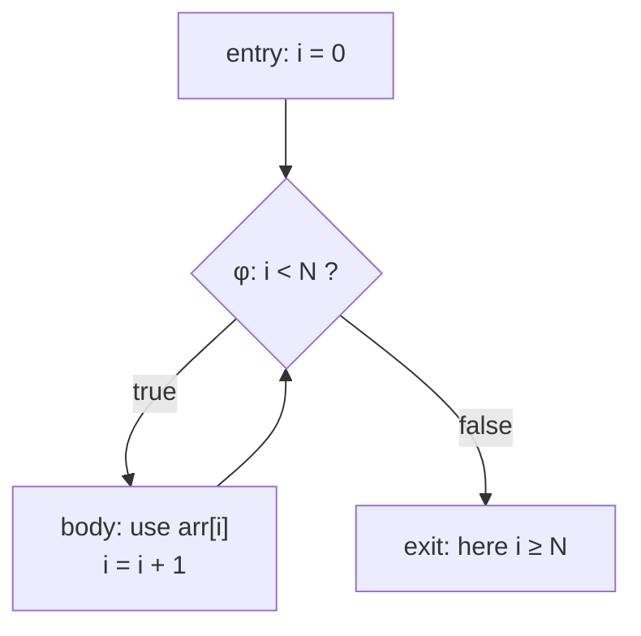

---

## Part 3 — LLVM, and how lowering to a GPU differs from a CPU

### 3.1 What LLVM is

LLVM is the compiler *infrastructure* behind clang (C/C++), rustc (Rust), Swift, Zig, Julia — and, less visibly, NVIDIA's own device compiler (NVVM is LLVM-based). Its design is the N+M diagram from §2.2 made real:

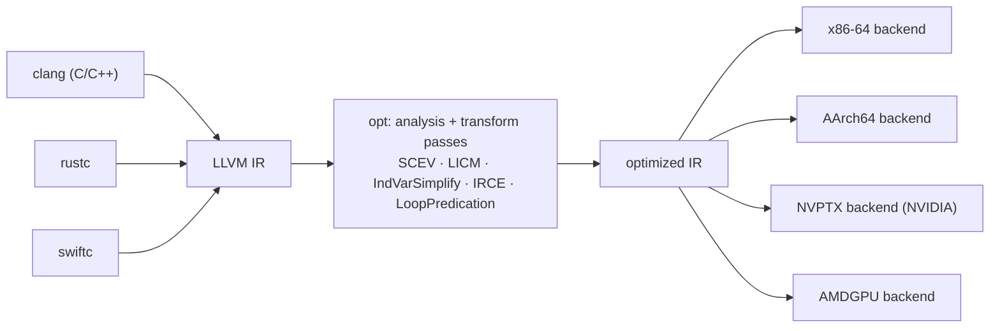

- **Frontends** produce LLVM IR. **Passes** (analyses + transforms) improve it. **Backends** select instructions, allocate registers, and emit assembly for one ISA.
- The pass most relevant to this project is **ScalarEvolution (SCEV)**: LLVM's *recurrence engine*. It represents a loop counter as an additive recurrence `{start, +, step}`, e.g. `i = {0,+,1}` for `for(i=0; i<N; i++)`, and computes **backedge-taken counts** (how many iterations a loop runs) and **ranges** (`getUnsignedRange`). Every modern bounds-check elimination in LLVM is built on SCEV. The repo's literature map calls it *"the reference recurrence engine"* and explicitly specs any upgrade of this project's loop analysis against its APIs.

### 3.2 CPU lowering vs GPU lowering — the actual difference

| | CPU target (x86-64, AArch64) | GPU target (NVPTX, AMDGPU) |
|---|---|---|
| Execution model | A few cores, out-of-order, branch-predicted | Thousands of threads in SIMT groups (§4) |
| IR → output | LLVM IR → instruction selection → register allocation → machine code | LLVM IR → **PTX** (NVIDIA virtual ISA) → driver **JITs** PTX → real **SASS** per GPU generation |
| Branches | Cheap-ish; predictor hides them | A divergent branch serializes both paths inside a warp — branchy code is *expensive* |
| Memory | Deep caches hide latency | Latency hidden by switching between thousands of threads |
| Checks/traps | Can compile a failed check to a trap/exception | No usable exceptions in shaders; a "failed" check must compute a fallback value |

The last row is quietly crucial for this project: on a CPU, an elided bounds check merely saves an occasional branch. On a GPU, each retained check adds a *divergent branch and a phi* **inside a loop body executed by all threads** — so the cost model (and the win from elision) has a different shape than the classic CPU literature would suggest.

Also note what this project does **not** use: Naga never touches LLVM. The WGSL path is WGSL → Naga IR → SPIR-V → vendor driver compiler (which itself is LLVM-derived on NVIDIA). Two parallel LLVM lineages (rustc for the host code, the driver for the shader), with Naga sitting in the middle of the shader one.

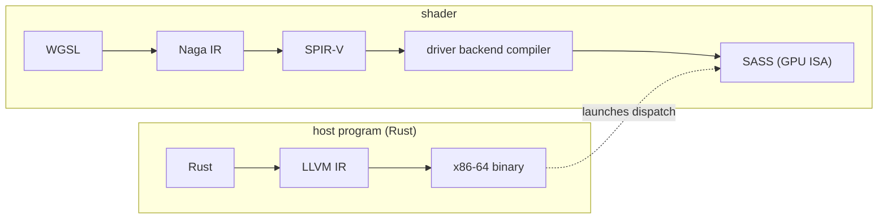

---

## Part 4 — GPUs: why they exist, how they execute, the architectures

### 4.1 Why GPUs exist at all

Start from the problem: graphics = "compute the color of millions of pixels, independently, 60+ times per second." That is massive parallelism with almost no shared state between items. You could throw CPUs at it, but CPUs are built for the opposite job:

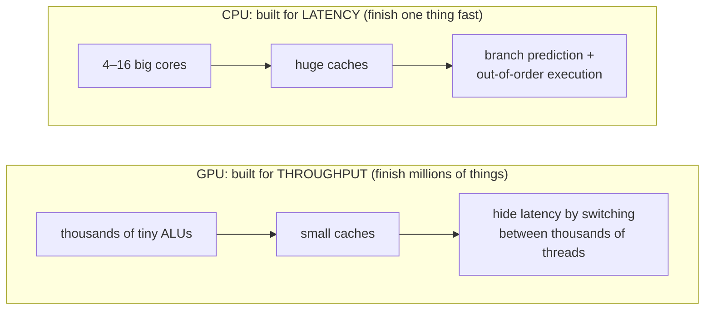

The GPU trick for hiding memory latency: while warp A waits on a load, the scheduler runs warp B, C, D… You need *lots* of independent work queued — which is exactly what graphics and data-parallel compute have.

### 4.2 SIMT: how GPU threads actually execute

- Threads are grouped: NVIDIA calls a group of 32 a **warp**; AMD historically 64 (**wave64**, now also 32 = wave32); Intel 8/16/32 subgroups. WebGPU's name is **subgroup**.
- A warp executes **one instruction for all its threads** (Single Instruction, Multiple Threads).
- **Divergence:** if threads in a warp take *different* sides of an `if`, the hardware runs both paths serially, masking each thread. That is why the bounds-check *branch* (not the comparison) is the expensive part of a retained check on a GPU.

### 4.3 The compute programming model (WebGPU terms)

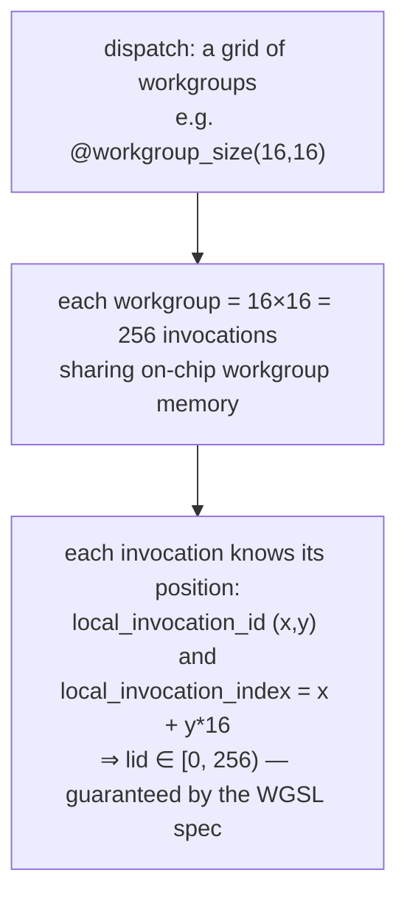

The WGSL spec *guarantees* `local_invocation_index ∈ [0, size.x·size.y·size.z)`. Hold that — it is the legal foundation of this project's first analysis (§8.2): it is a range proof that needs **zero** dataflow analysis, because it is true by specification.

### 4.4 Memory hierarchy

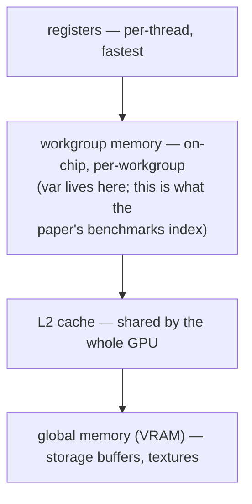

`var<workgroup>` arrays are the sweet spot for elision: their length is *statically known* (`array<f32, 256>`), unlike runtime-sized storage buffers (§8.7).

### 4.5 The architectures, briefly but honestly

| Vendor | Lineage worth knowing | Execution unit facts |
|---|---|---|
| **NVIDIA** | Fermi (2010, unified caches) → Pascal → Volta (independent thread scheduling + tensor cores) → Turing (RT cores) → **Ampere** → **Ada Lovelace** (2022 — the RTX 4060 Laptop GPU used for every benchmark in this repo) → Hopper/Blackwell (datacenter) | 32-thread warps; shared memory per workgroup; driver JITs PTX→SASS per generation |
| **AMD** | GCN (2012, wave64) → RDNA (2019, wave32/64 dual mode, gaming) / CDNA (compute, matrix cores) | Wave64 historically; wave32 on RDNA |
| **Intel** | Xe (2020→); Arc GPUs; Xe-HPC (Ponte Vecchio) | Subgroups of 8/16/32 |
| **Apple** | Unified memory; Tile-Based Deferred Rendering in mobile-class GPUs | Metal is the only native API |

Why one generic IR (SPIR-V) exists for all of these: vendors' driver compilers do the final per-generation codegen. Naga deliberately stops at SPIR-V/MSL/HLSL and lets each driver's compiler do ISA-specific work.

---

## Part 5 — Graphics APIs vs compute APIs

### 5.1 What a "graphics API" is

A graphics API (OpenGL, Vulkan, D3D12, Metal, WebGPU) drives a *fixed pipeline with programmable hooks*. The fixed stages do rasterization — you can't replace them, you only feed them:

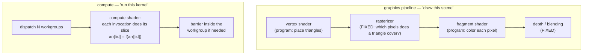

A **compute API** (or the compute half of a modern API) throws away geometry and rasterization entirely: you dispatch a grid of threads over abstract data. "GPGPU" = general-purpose GPU computing.

### 5.2 The API landscape

| API | Year | Kind | Language | Notes |
|---|---|---|---|---|
| CUDA | 2007 | compute only, NVIDIA-only | C++ dialect | No bounds checks at all (UB) — see §1.4 |
| OpenCL | 2009 | open compute | C-based | Declining on desktop |
| D3D12 / Vulkan / Metal | 2014–16 | graphics + compute | HLSL / GLSL+SPIR-V / MSL | Explicit, low-overhead; SPIR-V born here (Khronos) |
| WebGL | 2011 | web graphics | GLSL ES | No compute shaders; global state machine; validation-based safety |
| **WebGPU** | 2023 (Chrome), 2025 (Firefox) | web graphics + compute | **WGSL** | Safety + portability as first-class design goals — the reason this project exists |

### 5.3 Why WebGPU, and why wgpu

**The browser threat model** is the root cause of the entire project. A webpage is *untrusted hostile code*. WebGL-era browsers achieved safety by validating everything (slow, limits the API). WebGPU instead:

1. Runs the GPU work in a sandboxed process, and
2. **Requires that shader memory accesses have defined behavior** — a shader *cannot* read memory it doesn't own, *by specification*.

That mandate is implemented by compilers (Naga) injecting runtime guards on every array access. Safety is not optional in the browser, so the only path to speed is to prove guards unnecessary — *elision*.

**wgpu** is the Rust implementation of WebGPU. It runs in Firefox (which is why this work matters beyond one paper), in browsers' engine stacks, and natively (Bevy engine, simulations, tools). **Naga** is its shader compiler: WGSL in, SPIR-V/MSL/HLSL/GLSL out.

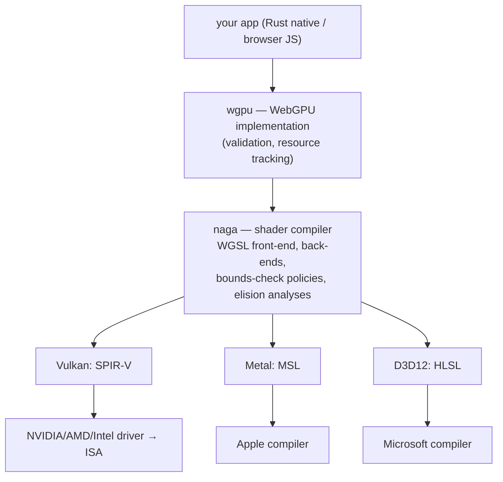

### 5.4 Naga's pipeline — and where this project's code sits

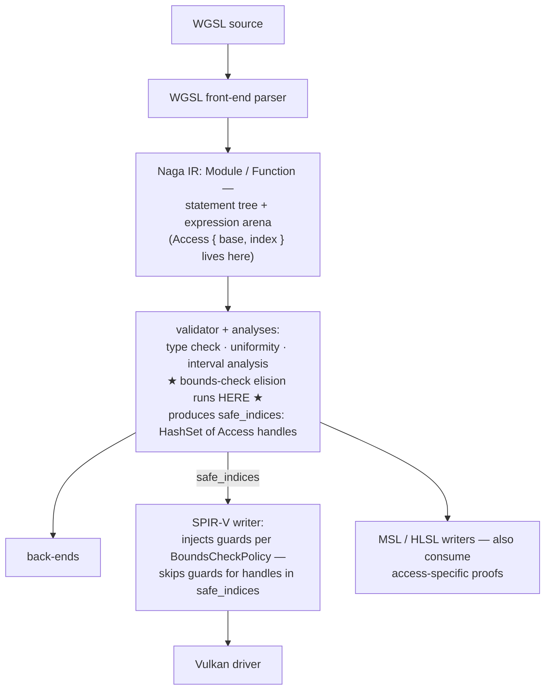

The three **BoundsCheckPolicy** variants (from `docs.rs/naga` — cited in the paper as [4]):

| Policy | OOB read | OOB write | Cost |
|---|---|---|---|
| `ReadZeroSkipWrite` (default, safest) | returns 0 | silently dropped | highest — full guard diamond |
| `Restrict` | clamped to last element | overwrites last element | clamp ops, but no branch |
| `Unchecked` | undefined behavior | undefined behavior | none |

---

## Part 6 — Bounds check elision: what it is, how it works, where it's seen

### 6.1 The thing being removed

For `var<workgroup> data: array<f32,64>` accessed at `data[lid + 1u]` under `ReadZeroSkipWrite`, Naga emits this SPIR-V diamond (from the paper, §2.2):

```
%cmp = OpULessThan %bool %idx %64      ; idx < 64?
       OpSelectionMerge %merge None
       OpBranchConditional %cmp %safe %merge
%safe = OpLabel
%val  = OpAccessChain ... %data %idx   ; safe path
%res  = OpLoad %float %val
       OpBranch %merge
%merge = OpLabel
%phi  = OpPhi %float %zero %entry %res %safe   ; pick value or 0
```

**Five extra instructions, 28 SPIR-V words, one divergent branch, one phi — per access, per iteration.** When the index is provably safe, all of it is elided and the output is *byte-identical to `Unchecked`* (measured: 399 = 399 words; §8.6).

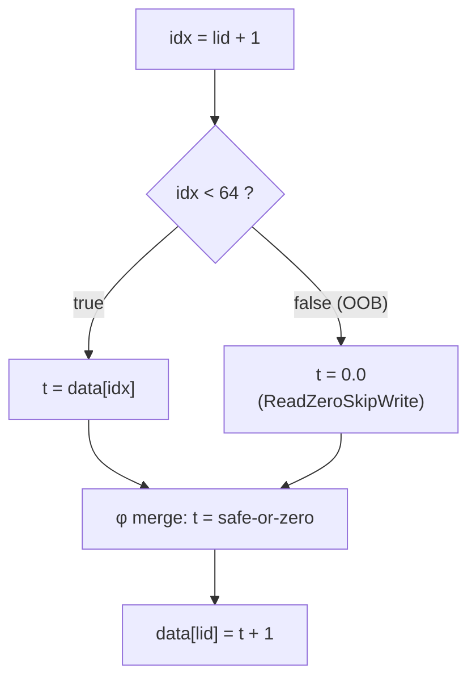

### 6.2 Loop invariance vs induction variables (the "loop invariance smth")

These two are constantly confused. They are different properties, both load-bearing for this work:

| | **Loop-invariant** | **Induction variable (IV)** |
|---|---|---|
| Definition | expression whose value **never changes** across iterations (`N`, `len(a)`, `a*b` if neither is written in the loop) | variable whose successive values form an **arithmetic progression**: `i = i + c` each iteration |
| Classic optimization | **LICM** — loop-invariant code motion: hoist the computation out of the loop into the preheader | **strength reduction** (replace `i*k` with additions), **IV elimination** (drop redundant tests) |
| Role in elision | a guard `if i < N` outside the loop, or `N` itself, is invariant — reuse it | knowing `i ∈ [start, bound)` on *every* iteration is what makes `a[i]` provably safe |

Formal vocabulary (Muchnick 1997, ch. 14 — the paper's [5]): a **basic IV** is `i = i + c` per iteration; the **family of IVs** is everything that is a linear function of a basic IV (`j = 2*i + 3`). A phi-recurrence `i₁ = φ(0, i₂); i₂ = i₁ + 1` is how SSA *represents* an IV — Go's `loopbce.go` literally matches this shape: `ind = Phi(min, nxt)`, `nxt = ind + inc`.

In SCEV language: `i = {0,+,1}<nsw>`, and the loop's **backedge-taken count** gives the range — that is the machinery that turns "this is a for-loop" into "i ∈ [0, N) at every access".

### 6.3 The canon — where these ideas come from (all referenced in `LITERATURE_...IV.md`)

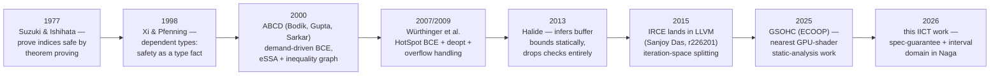

What each contributes to *this* project's vocabulary:

- **ABCD (PLDI 2000)** — the reviewers' touchstone. Uses *eSSA* (SSA augmented with conditional-assertion nodes) and a demand-driven search over an **inequality graph** to prove `0 ≤ i < len` where needed. Removed ~45% of dynamic checks. This project's `safe_indices` set is "a degenerate special case of its constraint propagation" (literature map's own words).
- **Würthinger 2007/2009 (HotSpot)** — conditions on index expressions in SSA; hoisting partially-redundant checks out of loops; the 2009 journal version handles **integer-overflow edge cases of the bound condition itself** (exactly this project's hazard class) and gives an honest result: *bounds checks often don't matter* — see Readyset below.
- **IRCE (LLVM 2015)** — for `0 ≤ A·I + B < Length`, **splits the iteration space** into pre/main/post loops; in the main loop the check is provably always-true and disappears entirely. This is the *general form* of this project's `if i < N else break` pattern (which matches only `A=1, B=0` with literal bounds).

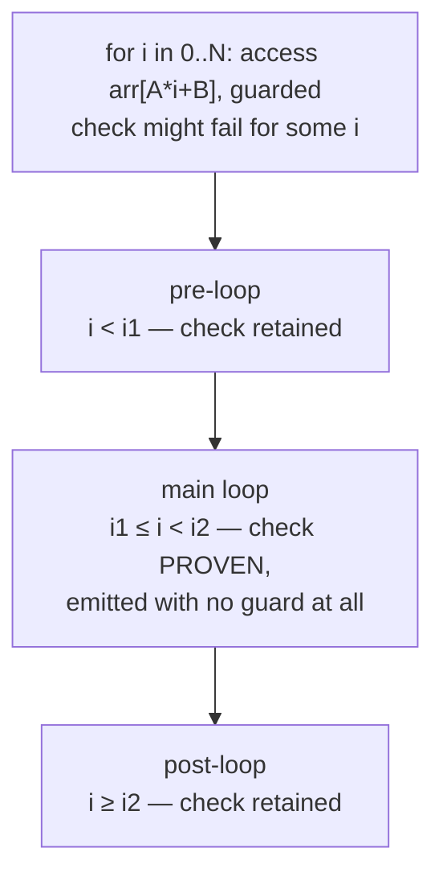

- **Go compiler (closest production cousin)** — `cmd/compile/internal/ssa/prove.go` (dominator-tree fact propagation; "Proved IsInBounds") + `loopbce.go` (`parseIndVar`). Gold-standard testing style: `test/prove.go` annotates each expected elimination inline — the repo adopted this pattern for Naga stress tests.
- **LLVM SCEV** — `{start,+,step}` recurrences, backedge-taken counts, `getUnsignedRange`. The blueprint for upgrading from "pattern matching" to true recurrence recognition.
- **Rust/rustc** — emits bounds checks at MIR lowering, then *delegates all elimination to LLVM* (SCEV/IRCE above). Rust never does loop-aware BCE itself.
- **Halide (PLDI'13)** — the architectural cousin of the spec-guarantee trick: bounds are *inferred from the schedule algebra*, so checks vanish by construction.
- **GSOHC (ECOOP 2025)** — nearest prior work in GPU-shader static analysis; used to position novelty honestly.
- **The honest counterpoint — Readyset 2022**: removed 651 real bounds checks from a production Rust hot path and measured **≈ no win** (branch prediction + LLVM's local optimizations absorb them). Any motivation section that ignores this gets eaten by reviewers; the corpus study in this work (§8.6) is partly the answer — on *GPUs*, in *interpreted-in-browser* contexts, with divergent branches, the cost profile is different, and the win concentrates in specific shapes (loops × fixed-size workgroup arrays).

**Where elision is seen in the wild, summary:** Java HotSpot (Würthinger), Go (`prove`/`loopbce`), every Rust program via LLVM (IRCE/SCEV), JavaScript engines (JITs do the same range reasoning), Halide, dependent-typed languages (DML) — and, after this work, plausibly **Naga/wgpu** for the web's mandatory-safety model, where it is not an optimization nicety but the *only* way to reach CUDA-like raw speed (§8.1).

---

## Part 7 — The IICT 2026 work itself

### 7.1 The gap and the use case

The origin is the **DAVE multibeam sonar plugin** (`README.md`: a Gazebo/ROS sonar simulation). Its compute pipeline was ported from CUDA (`sonar-gpu`) to **WGSL via wgpu** (`sonar_wgpu/` — Rust library, C ABI, `.wgsl` shaders; `dave_ws/src/dave` symlinks back to it). The sonar kernel does exactly the expensive shape: repeated indexed access into workgroup arrays inside loops — scatter, reduce, GEMM, FFT stages (the CUDA benchmark harness `cuda_bench_harness.cu` mirrors it).

The gap, precisely:

- The WGSL port *must* be safe (it may one day run in-browser; and `ReadZeroSkipWrite` prevents real memory corruption — verified on hardware, §7.6).
- That safety costs a guard on **every** access — including the hundreds of provably-safe ones in the hot loop.
- CUDA pays nothing because it has no safety at all (§1.4). So the port looked inherently slower.

**The idea:** the WGSL spec itself hands you free proofs. Two of them, in fact — the `local_invocation_index` guarantee, and the exit condition of every well-formed loop.

### 7.2 Analysis 1 — builtin index safety (spec guarantee)

The narrowest, most airtight proof in the whole design. No dataflow analysis needed — the guarantee is unconditional:

> WGSL spec: `local_invocation_index ∈ [0, size.x·size.y·size.z)` for every invocation of the entry point.

So: `var<workgroup> data: array<f32,256>` indexed *directly* by `local_invocation_index` in a `@workgroup_size(256)` kernel can **never** be OOB. Elide. Anything less direct (`lid+1`, `lid*2`, undersized arrays) keeps its guard.

*(This mermaid flow replaces the lost Figure 2 of the paper — the original figure PDFs lived in `/tmp` and were lost when the machine restarted.)*

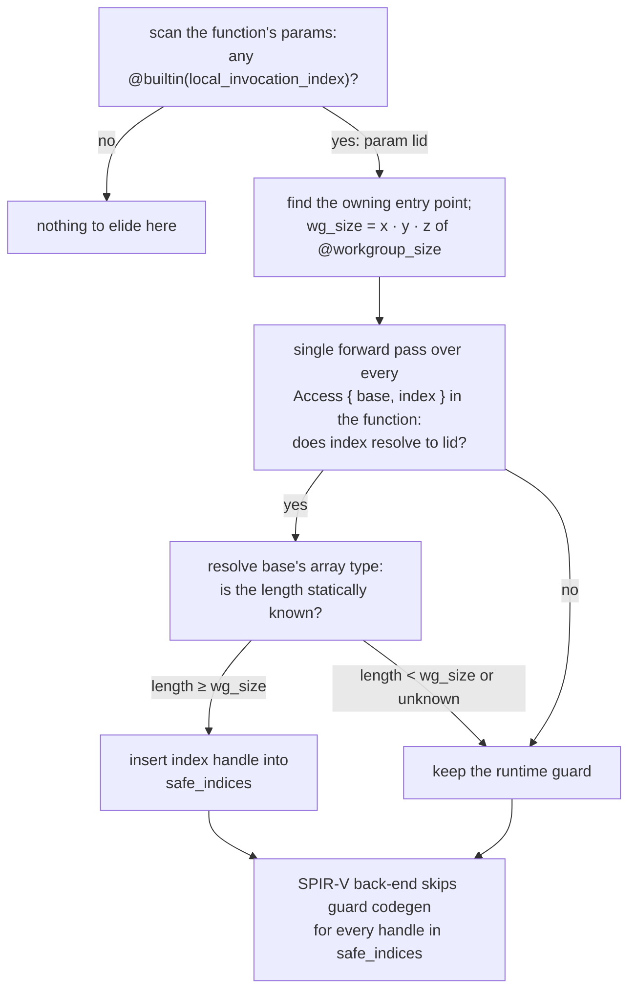

Implementation: one forward pass in `ModuleInfo::process_function` (`naga/src/valid/analyzer.rs`), after expression/uniformity analysis, before backends inject checks.

### 7.3 Analysis 2 — loop induction variable (the if-break pattern)

WGSL has no `for` statement in its IR — `for`/`while`/manual loops all lower to `loop { … if i < N { } else { break; } … }`. That exit condition *is* a range proof: **inside the loop body, i < N holds on every iteration**. If the array length ≥ N, `data[i]` is safe. Also handled: WGSL's `break if` — `break if i >= N` gives bound N; `break if i > N` gives bound N+1.

*(Replaces the lost Figure 3.)*

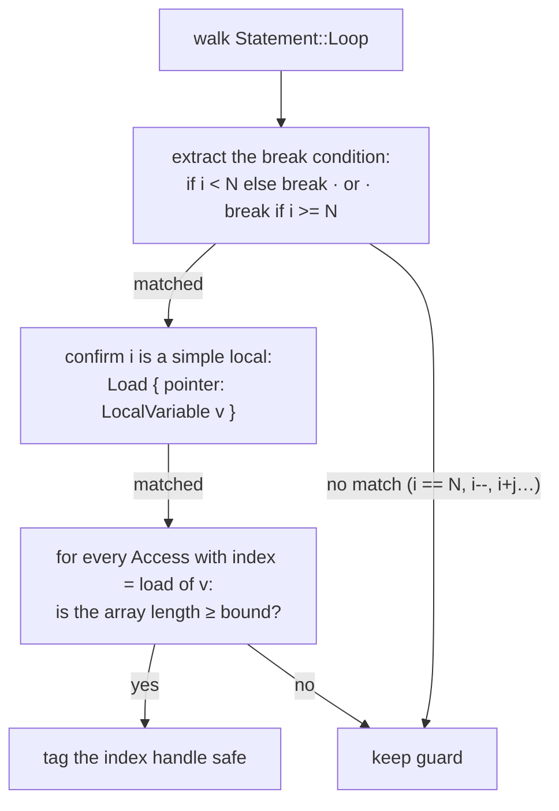

**Known gaps of the pattern-matcher (documented in FINDINGS §7a):** equality/decrement loops (`i == 0`), complex indices (`i+j`, `i*stride`), shadowed variables in nested loops, and non-zero starts over-approximating (i starts at 16, bound 64, array 48 → check kept although actually safe). These gaps are exactly what the interval rewrite (§7.5) and the upgrade ladder (§9) target.

### 7.4 Wiring — where the code actually sits

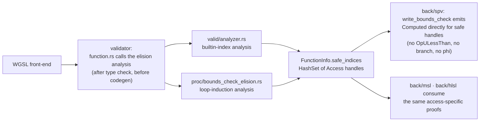

Historical note worth knowing (FINDINGS §1a): Naga already *contained* an interval analysis — but a wiring bug (wrong argument order, `function.rs:1942`) meant the elision was **never actually called**. First real contribution: fix the wiring. The analyses then grew from there.

### 7.5 The soundness rewrite — from pattern matching to a path-sensitive interval domain

**Why the pattern analyses were risky.** A pattern matched somewhere in a function and recorded *function-wide* can be reused where it no longer holds:

- **Stale captured load:** `j = lid` is loaded *before* `lid = lid + 100` mutates it; the proof "lid ∈ [0,255]" silently rides along and certifies a post-mutation access.
- **Sibling branches:** a proof established on one branch edge must not certify code on the other edge.

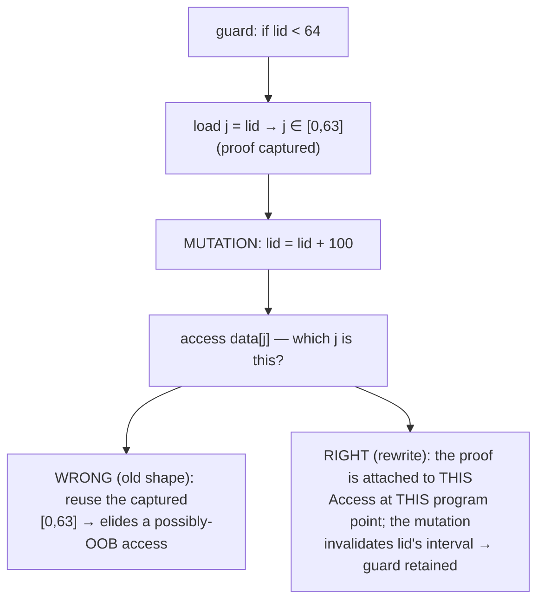

**The six features of the rewrite** (paper §3.4, commit `8757d7d` in the `wgpu` repo, Aug 28):

1. **Bounded intervals** — signed and unsigned 32-bit intervals; any endpoint arithmetic that could overflow/underflow is *rejected* (falls back to a retained check) rather than guessed.
2. **Condition refinement** — `i < N` narrows `i`'s interval on the taken edge; merges take the conservative hull (join).

```mermaid
flowchart TD
  top["on entry: i ∈ [0, 2³²) (unknown u32)"] --> cond{"branch: i < 64 ?"}
  cond -->|"true edge — refine"| safe["i ∈ [0, 63]<br/>data[i] provably safe here"]
  cond -->|"false edge — refine"| uns["i ∈ [64, 2³²−1]<br/>not provable here"]
  safe --> join["merge = conservative join:<br/>hull back to [0, 2³²)<br/>the proof does NOT leak past the merge"]
  uns --> join
```

3. **Mutation invalidation** — any `Store`/atomic update to a local kills its interval; the stale-captured-load unsoundness class is eliminated by construction.
4. **Monotone recurrences** — loops with explicit start/step/exit recognized in either direction; **equality exits** (`if i == N break`) accepted only with reachability + no-wrap proofs.
5. **Affine indices** — `A·lid + B` and `A·i + B` resolved by interval arithmetic on A and B (generalizing the point-range spec guarantee).
6. **Conservative fallback** — runtime-sized storage arrays and any unsupported shape always keep their guard.

And the key invariant: **each proof attaches to the specific `Access` expression at its program point**, never to a variable — facts cannot cross statements, branches, or iterations.

**Validation:** adversarial proof-scope suite (guard-before-access, sibling branch, after-loop, mutation-after-guard, calls, switches, hidden updates — all must *retain*), plus must-elide cases checked byte-identical to `Unchecked`. Full suite: **272 Naga tests + 58 stress tests green**, clippy/rustfmt clean.

### 7.6 Results

**SPIR-V word counts (the cleanest signal):**

| Benchmark | Checked | Unchecked | Delta |
|---|---|---|---|
| Minimal shader (elided) | 176 | 176 | **+0 — byte-identical** |
| Minimal shader (retained) | 213 | 185 | +28 (the guard) |
| Matmul (elided) | 399 | 399 | **+0 — byte-identical** |
| Matmul (retained) | 432 | 404 | +28 |

**GPU timing (RTX 4060 Laptop, Vulkan; clean single-dispatch matmul):** elided = 0 ns vs Unchecked; retained = +7.7–8.2 µs per dispatch at 262,144 evaluations ≈ **~9 ps per bounds check** (~5–6 GPU cycles). OOB hardware verification also passed: under `ReadZeroSkipWrite`, an OOB read returned 0.0 and an OOB write was silently dropped; under `Unchecked` the same kernel read real memory (13.0) and wrote 999.0 — the policies genuinely work.

**Corpus hit-rate study** (295 deduplicated valid WGSL programs; harness `corpus_hit_rate`, commit `6ff062b`; full method + reproduce commands in `corpus_hit_rate/results/RESULTS.md`):

| Corpus (unique valid files) | Checks | Elided | Rate |
|---|---|---|---|
| naga test suite (153) | 587 | 8 → 435 | 1.2% → **74.1%** |
| — inside compute kernels | 504 | 8 → 413 | 14.6% → **81.9%** |
| webgpu-samples, official (66) | 92 | 2 → 1 | 2.2% → 1.1% |
| wgpu upstream tree (76) | 79 | 2 → 2 | 0.2% → 2.5% |

```mermaid
pie title naga test corpus — 587 dynamic checks after the rewrite
  "elided (435)" : 435
  "still guarded (152)" : 152
```

Code-level cross-check: emitted `OpULessThan` instructions on the project corpus fell **505 → 134 (−73%)** — consistent with the IR-level 74.1%.

### 7.7 Honest limits

- **Runtime-sized storage buffers dominate the external residual**: 69 of 79 un-elided accesses in the wgpu upstream tree are runtime-length arrays whose length no compile-time analysis can know without a dominating guard. Shipped WGSL also just rarely uses dynamic indexing (~1.3 runtime-indexed accesses per shader) — so the absolute ceiling on external code is small. The big wins are where loops meet fixed-size workgroup arrays — i.e., exactly the compute-kernel shapes this project came from.
- **Measurement culture counterpoint** (kept deliberately in the literature map): Readyset removed 651 real Rust bounds checks with ≈ no measurable win. CPU ≠ GPU ≠ browser, but the burden of proof is on the optimizer — which is why the paper freezes legacy timing tables as non-headline until the schema-v3 provenance-complete rerun (blocked on the NVIDIA driver at last check, `BOUNDS_CHECK_ELISION_TODO.md` §5).

---

## Part 8 — The whole repository, dated: everything that was actually done

The paper is only the visible tip. Sorting the repo by file modification dates and git history reconstructs the real chronology — including work that never made it into the paper text.

```mermaid
flowchart LR
  mar["Mar 16<br/>DAVE sonar WGPU port<br/>skeleton (dave_ws, README)"] --> jun["Jun 25–27<br/>sonar pipeline + CUDA bench;<br/>Track-2/3 naga work:<br/>API-constant ranges +<br/>barrier elision (f08a9bf1)"] --> jul["Jul 1–8<br/>builtin analysis wired,<br/>loop-induction analysis,<br/>5 benchmark suites,<br/>FINDINGS + paper v1"] --> aug25["Aug 25<br/>LITERATURE map (R4 answers);<br/>wgpu repo: loop-induction elision<br/>(86eb81c), stress suite (f105ff1),<br/>verify crates (500dd82);<br/>corpus harness (96ac42a)"] --> aug27["Aug 27<br/>audits (AUDIT_INVENTORY,<br/>TEST_BENCHMARK_AUDIT);<br/>schema-v3 runner (dd4f5bb);<br/>corpus v5 fixes (facb021)"] --> aug28["Aug 28<br/>★ interval-domain rewrite<br/>(8757d7d) · corpus v5 final<br/>(6ff062b, 74.1%/81.9%) ·<br/>paper v2 compiled"] --> aug30["Aug 30–Sep 1<br/>repos archived<br/>(unzip-after-sih,<br/>projects-source-backup)"]
```

### 8.1 June: the Track-2/3 work that predates the paper (naga `f08a9bf1`, Jun 27)

Before the loop-induction analysis existed, two narrower tracks were implemented in the standalone `naga` repo (commit `f08a9bf1`, 167 insertions):

- **Track 2 — API-constant range analysis:** `builtin_index_provably_in_bounds()` in `proc/index.rs` — the ancestor of §7.2's builtin analysis, implemented at the *SPIR-V writer* level: `write_bounds_check` returns `Computed` directly when the builtin is provably in bounds, skipping all guard codegen. The writer learns `current_workgroup_size` from the entry point.
- **Track 3-lite — workgroup post-barrier elision:** a different optimization entirely — eliding the redundant *post-barrier load* after `workGroupUniformLoad` by forward-scanning for subsequent writes to workgroup memory (stopping at the next barrier), with conservative pointer tracing through `Access`/`Load` to `var<workgroup>` globals.

Why this matters historically: the elision idea was proven at the codegen level in June, then **re-architected into the validator/analyzer level** in July–August so that *all* backends (SPIR-V, MSL, HLSL) can consume proofs — that re-architecture is what the paper describes.

### 8.2 July: measurements, and the paper's first version

- Five benchmark binaries (`bce_bench2`, `loop_bench`, `matmul_bench`, `oob_test`, `spv_saver`) — produced the "brutal truth" methodology findings: at high dispatch counts, **pipeline submission latency dominates** and the GPU scheduler hides single checks; the SPIR-V word count is the only reliable microbenchmark signal; only the single-dispatch matmul produced clean timing.
- `BOUNDS_CHECK_ELISION_FINDINGS.md` (Jul 8) and paper v1 (`iict2026_bounds_check_elision.tex`).
- `NAGA_PROBLEMS_AND_IMPROVEMENTS.md`, `builtin_info.txt`, `wgsl.html` (spec dumps) — the study layer underneath.
- `cuda_bench_harness.cu` — established the CUDA baseline: 2–3 µs scatter kernel regardless of size, zero bounds checking, i.e. the speed target that safety-frugal WGSL is compared against.

### 8.3 Aug 25 — the reviewer-driven expansion (commit wave in `wgpu`)

The literature map (`LITERATURE_...IV.md`, curated Aug 25) answered Reviewer 4's induction-variable/recurrence questions with a concrete upgrade ladder, and the same day four commits landed in the `wgpu` repo:

| Commit | What |
|---|---|
| `86eb81c` | feat(naga): loop-induction-variable bounds-check elision (§7.3) |
| `87c6744` | feat(wgsl): accept `enable subgroups` (for subgroup reduction testing; caused the one known test-suite failure — documented, not hidden) |
| `f105ff1` | test(naga): elision stress suite + soundness assertions + snapshots |
| `500dd82` | chore(experiments): `elision_gap_test` (probes which loop patterns still fail to elide — a *documented* gap list) and `gpu_dispatch_verify` (end-to-end Vulkan dispatch verification of elided vs retained) |

Also: `corpus_hit_rate` harness v1 (`96ac42a`), benchmarking standard adopted in `bounds-check-testing-framework` (`e35287b`), and naga-side soundness assertions (`d45bcb65`).

### 8.4 Aug 27 — the audit layer (what makes the numbers citable)

`AUDIT_INVENTORY.md` + `TEST_BENCHMARK_AUDIT.md` are the honesty infrastructure: they separate *verified* state from *invalid or incomplete* evidence. Examples of self-flagged issues: legacy performance JSON lacks exact source revisions; legacy policy comparisons don't isolate the BCE analysis; one legacy matmul arm was itself out-of-bounds; GPU timing blocked by Vulkan/NVIDIA adapter init failure in that environment. Six **evidence gates** are listed that paper claims must pass before being made. This is why paper v2 freezes legacy timing as "non-headline" and leads with SPIR-V identity + corpus numbers instead.

Also landed: `schema-v3` paired benchmark runner (`dd4f5bb`) — provenance-complete (git revisions, driver, GPU, warmup, confidence intervals in every result file) — and the corpus harness made auditable (`facb021`).

### 8.5 Aug 28 — the headline: soundness rewrite + final corpus + paper v2

- `8757d7d` (wgpu, 00:25): the interval-domain rewrite (§7.5) — the six features, adversarial suite, 272+58 tests green.
- `6ff062b` (corpus_hit_rate, 00:26): final v5 results — 74.1% / 81.9% (§7.6), with the *before* numbers (1.24% / 14.55%) preserved as the historical baseline.
- `iict2026_bounds_check_elision_v2.tex` → 8-page PDF (00:30): adds the interval-domain section, adversarial-test description, before→after corpus table, OpULessThan cross-check, and the honest-limits abstract.
- `9cbf9af` (testing framework): TODO updated — GPU rerun explicitly **blocked on the NVIDIA driver** (`nvidia-smi` cannot communicate).

### 8.6 Standing blockers (as archived)

From `BOUNDS_CHECK_ELISION_TODO.md`: headline paired GPU measurements under schema v3 (negative controls + balanced samples) are blocked on the driver; figures were lost with `/tmp` (the mermaid diagrams in this document, §7.2–7.5, can serve as replacements to re-export); differential execution across SPIR-V/MSL/HLSL backends and interval fuzzing remain open.

---

## Part 9 — Where it goes next, and how to navigate the repo

### 9.1 The upgrade ladder (from the literature map — sourced, smallest-first)

1. **Dominating-condition facts** — any variable proven under a dominating `if j < len` (the ABCD/Go-`prove` smallest subset; expected to eat much of the runtime-buffer residual *when a guard exists*).
2. **True recurrence recognition** — replace comparison-shape matching with phi+step (`{start,+,step}`) identification, à la Go `parseIndVar` / SCEV; enables decrement loops and derived IVs.
3. **Affine forms `arr[i±c]`** (already partially in the rewrite) and **eq-exits via monotonicity** (in, gated on proofs).
4. **Overflow discipline** as a first-class test axis (unsigned wrap, negative starts) — Würthinger 2009 is the blueprint.
5. Inline-annotated expectation tests à la Go `test/prove.go`; ranked-by-yield corpus targeting (the shape classification already ranks the next pattern: 69/79 external misses are runtime-length storage arrays).

### 9.2 Why wgpu is exactly where this pays

- WebGPU *mandates* the safety that CUDA skips — so elision is not optional polish; it is **the only mechanism** that lets browser-shipped and native wgpu compute reach raw-pointer speed without giving up the safety the web requires.
- The fires-light-up-here shapes — fixed-size workgroup arrays indexed by lid or an IV inside loops — are the standard building blocks of tiled matmul, reductions, histograms, prefix scans, convolutions: i.e. the compute kernels wgpu apps (and the sonar pipeline that started all this) are made of.
- Deployment surface: wgpu runs in **Firefox's WebGPU** and in native Rust stacks (Bevy et al.) — every elided guard is a spec-compliant, zero-cost access on all of them; MSL/HLSL backends already consume the same access-specific proofs, so the win is not Vulkan-only.

### 9.3 File map (what to open for what)

| Curious about… | Open |
|---|---|
| The paper itself | `iict2026_bounds_check_elision_v2.tex` / `.pdf`; venue doc `IICT 2026-3-1.pdf` |
| Every measurement story | `BOUNDS_CHECK_ELISION_FINDINGS.md` |
| The citation web + R4 answers | `LITERATURE_BOUNDS_CHECK_ELISION_AND_IV.md` |
| What remains / evidence gates | `BOUNDS_CHECK_ELISION_TODO.md`, `AUDIT_INVENTORY.md`, `TEST_BENCHMARK_AUDIT.md` |
| Corpus numbers + reproduce | `corpus_hit_rate/results/RESULTS.md` |
| The rewrite commit | `wgpu` repo, commit `8757d7d` (branch `bounds-check-elision`) |
| The June codegen-level proof-of-concept | `naga` repo, commit `f08a9bf1` |
| The sonar origin | `README.md`, `sonar_wgpu/`, `dave_ws/src/dave` → `~/sonar-gpu` |
| Benchmark standard / runner | `bounds-check-testing-framework/` (ARCHITECTURE.md, BENCHMARKING_STANDARD.md, `paired-vulkan-v3/`) |

### 9.4 Glossary

| Term | Meaning |
|---|---|
| **ABCD** | Bodík/Gupta/Sarkar PLDI 2000 — demand-driven bounds-check elimination via inequality graphs |
| **eSSA** | SSA extended with conditional-assertion nodes (ABCD's substrate) |
| **BCE** | bounds-check elision — removing a runtime guard proven unnecessary |
| **CFG / SSA / φ** | control-flow graph / single-assignment form / phi merge node |
| **Dominators** | A dominates B if every path to B passes through A; dominating guards are the cheapest safe elisions |
| **Interval domain** | abstract values $[lo,hi]$ instead of concrete integers; refinement narrows, join takes the hull |
| **IR** | intermediate representation — the middle of the N+M compiler diagram |
| **IRCE** | LLVM's Inductive Range Check Elimination — iteration-space splitting (pre/main/post loops) |
| **IV** | induction variable — loop counter in arithmetic progression; basic IVs spawn a family of linearly derived IVs |
| **LICM** | loop-invariant code motion — hoisting loop-invariant work out of loops |
| **MSL / HLSL / SPIR-V / PTX / SASS** | Metal Shading Language / Direct3D HLSL / Khronos binary IR / NVIDIA virtual ISA / NVIDIA final ISA |
| **Naga** | wgpu's Rust shader compiler: WGSL → IR → SPIR-V/MSL/HLSL/GLSL |
| **OOB / UB** | out-of-bounds access / undefined behavior |
| **SIMT / warp / wavefront / subgroup** | one instruction for a group of lockstep threads (32 NVIDIA, 64/32 AMD, 8/16/32 Intel) |
| **SCEV** | LLVM's ScalarEvolution — recurrence engine, `{start,+,step}`, backedge-taken counts |
| **WGSL / WebGPU** | the web shader language / the web GPU API whose spec mandates defined OOB behavior |
| **Workgroup memory** | on-chip per-workgroup storage (`var<workgroup>`); statically sized arrays live here |

---

*End of guide. Generated from the repository's own evidence; every number above is traceable to a file listed in §9.3.*
